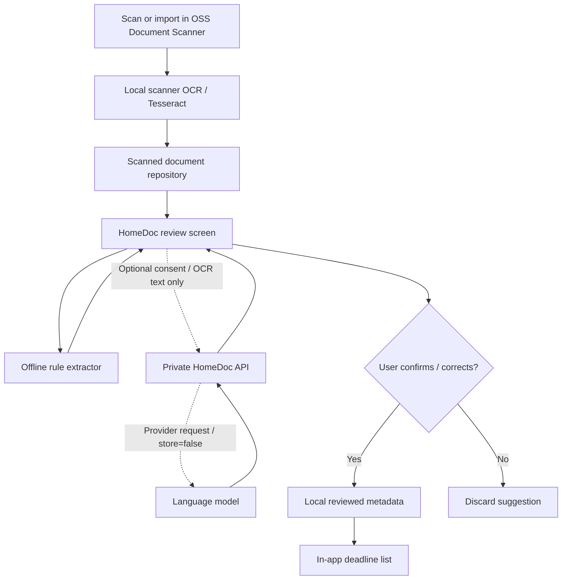

# HomeDoc AI — software architecture (MVP → production)

**Status:** NativeScript overlay implemented, unit-tested offline extraction, optional HTTP LLM extraction prototype implemented; native iOS/Android compile not verified.

## Product problem and boundaries
HomeDoc turns OCR from existing scanned documents into candidate fields (category, payment/expiry date, amount), lets a human correct those fields, and saves *reviewed* metadata. It must not infer unknown dates, make payments, give legal advice, or upload anything without consent. Notifications are not yet implemented in this MVP; a confirmed deadline appears in the HomeDoc list.

## Current upstream integration (verified against upstream raw files on 2026-10-14)
- `app/components/list/DocumentsList.svelte`: HomeDoc action inserted into scanner's existing FAB row.
- `app/homedoc/HomeDocHub.svelte`: new NativeScript/Svelte page for list → review → save.
- `app/services/documents.ts`: existing `documentsService.documentRepository.findDocuments()` supplies document objects.
- `app/models/OCRDocument.ts`: `document.pages[].ocrData.text` supplies OCR after the scanner ran OCR.
- `app/homedoc/store.ts`: local metadata only, app `ApplicationSettings` (not encrypted).
- `app/homedoc/analyzer.mjs`: fully offline rule-based suggestions; shared by browser preview and native.
- `server/index.mjs`: optional consent-gated developer API that proxies to an LLM using Responses Structured Outputs. Credentials are server-only. Server is **development-only**, not public production infrastructure.

## Data flows


## State machine
- `scanned`: scanner has image/PDF; OCR might not be available.
- `suggested`: local (or optional AI) candidate fields present; **never actionable yet**.
- `reviewed`: user explicitly saves corrected fields; `confirmed = true`.
- `actionable`: user-confirmed date appears in due list; OS notifications are future work.
- `deleted`: user removes HomeDoc metadata; scan stays in scanner.

## Minimal reviewed record
```json
{
  "documentId": "scanner-document-id",
  "title": "Electricity bill",
  "category": "bill",
  "dueDate": "2026-11-25",
  "amount": "52.40",
  "currency": "EUR",
  "savedAt": 1790000000000,
  "confirmed": true
}
```
Raw OCR is **never saved** by the native HomeDoc overlay. It is read from the scanner's repository when reviewing. Browser prototype deliberately stores synthetic OCR in localStorage for interactivity; do not enter confidential material there.

## AI behavior and safeguards
1. Extract only from OCR and emit blank when evidence is absent.
2. Use labeled deadline heuristics offline; reject ambiguous day/month dates and invalid calendar dates.
3. Cloud AI is opt-in *for each request*; prompt for endpoint and a development token; **never store server access token or model API key in app settings**.
4. The model response must match a JSON Schema and include a verbatim evidence excerpt for each proposed deadline/amount. The server removes unsupported values.
5. Every field remains editable and cannot be saved without a user action.
6. Failure of OCR/AI must not prevent normal scanner functionality.
7. Model output is untrusted; date parsing and record validation happen in deterministic code. No autonomous payment, mail, or external action.

## Security and privacy gaps blocking production
- The current local metadata in `ApplicationSettings` is **not encrypted**. Move sensitive metadata to encrypted SQLite/OS-protected storage with Keychain/Keystore integration.
- Define privacy policy, retention/delete flows, and backup encryption; audit upstream sync/export paths.
- Lock the optional API behind HTTPS, authenticated accounts, throttling, monitoring with redacted logs, error sanitation, and abuse prevention before any public deployment.
- Scrub PII from telemetry; collect no document content as analytics.
- Multi-language extraction tests, OCR accuracy evaluation, and data-consistency/migration tests are required.
- Reconcile deleted/upgraded upstream documents; handle IDs, folders, and background sync events.

## Production architecture candidate
Use a proper encrypted metadata database in the app, a small AI endpoint behind authentication, and platform native reminders via `UNUserNotificationCenter`/Android notification channels. The app should operate fully without the AI endpoint. Consider offering opt-in user-paid AI credits only after cost and privacy validation.

## Licensing
The upstream scanner is MIT-licensed. This add-on is independently authored code and should retain attribution for OSS Document Scanner and its original licensing in any distributed fork. Review native plugin, OCR language files, fonts, and other third-party licenses separately before sale.
